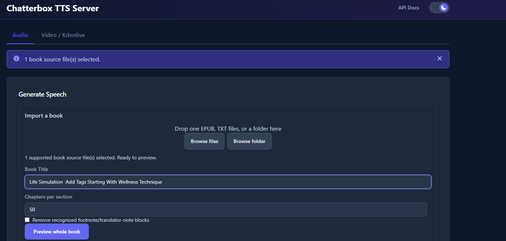
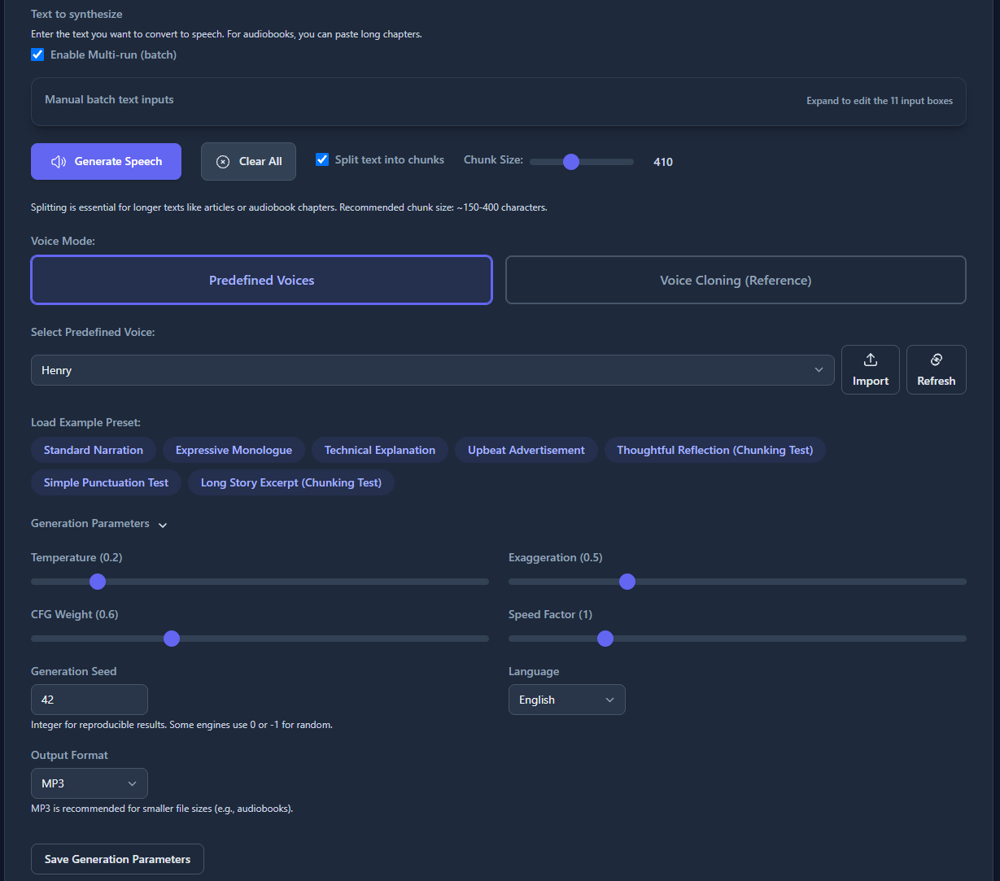
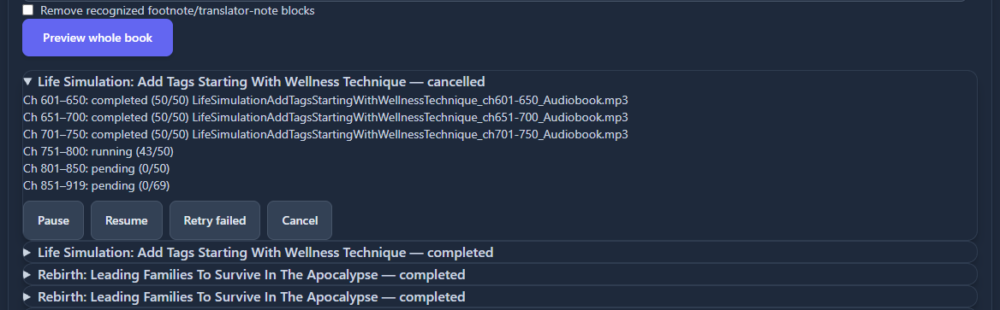
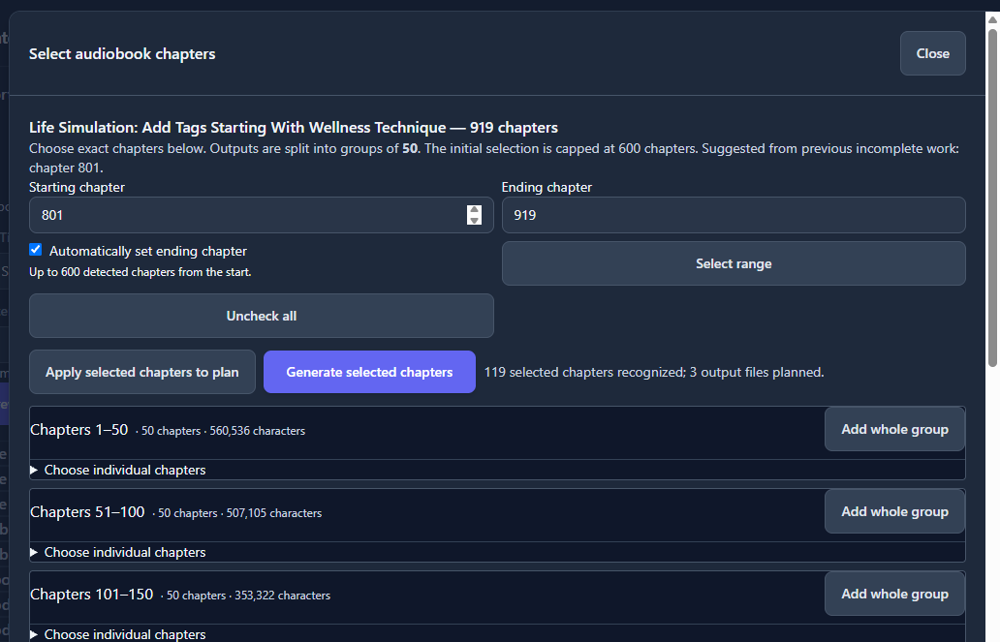
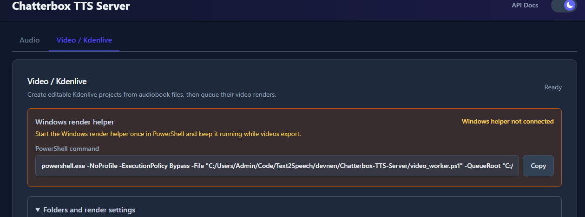
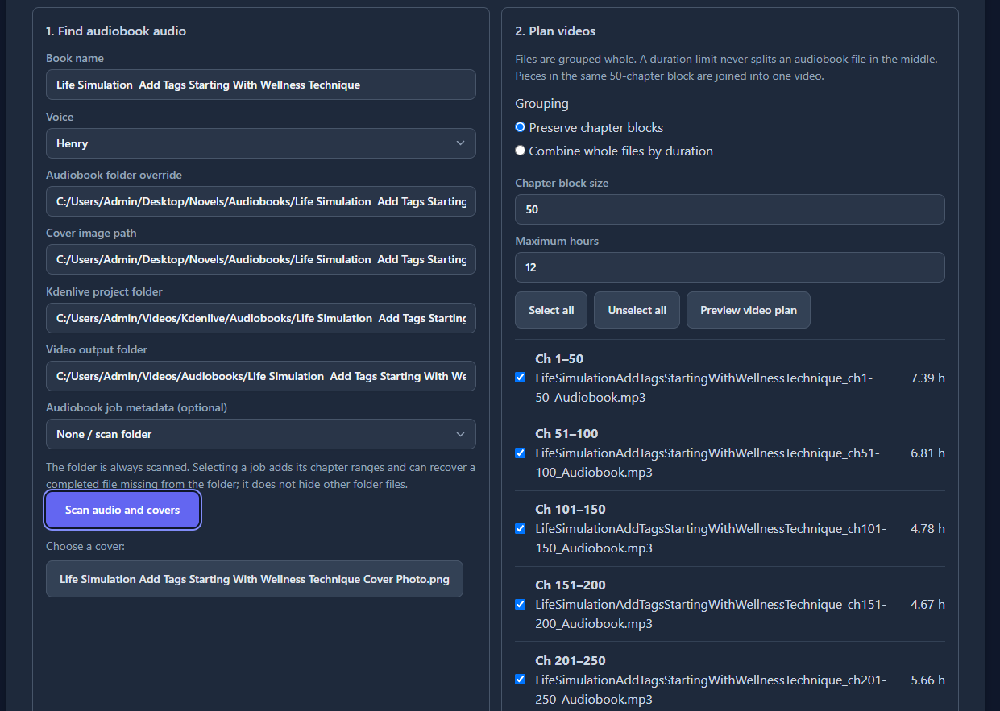
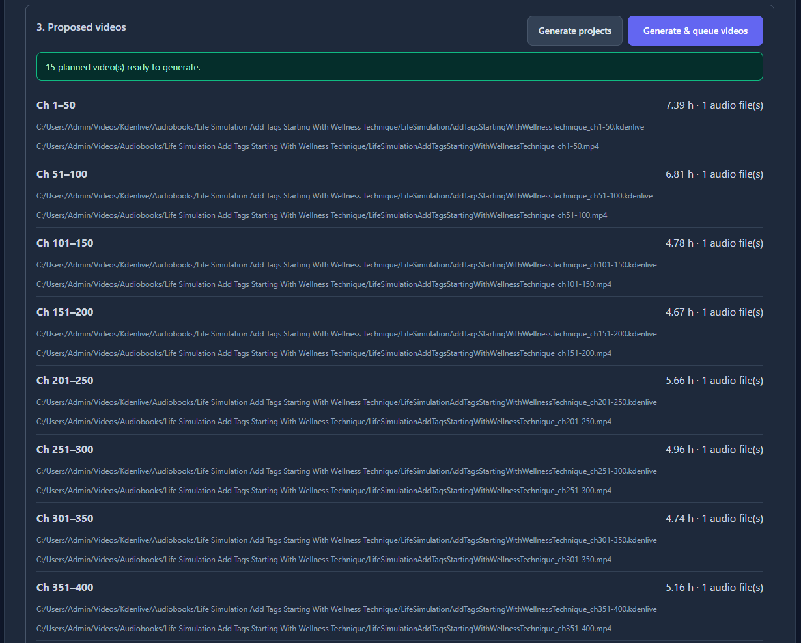
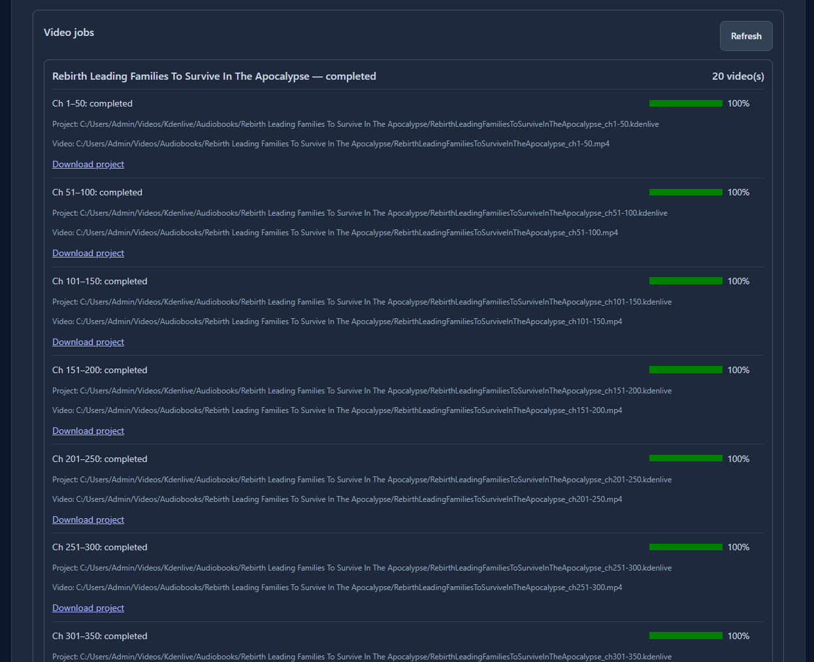
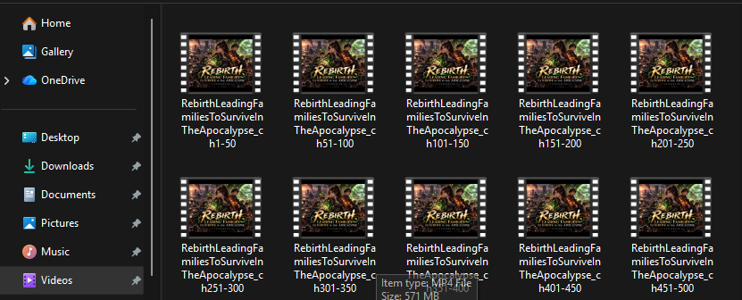

# Chatterbox TTS Server

Self-hosted text-to-speech, voice cloning, long-form audiobook generation, and optional Kdenlive video export—available through a browser UI and FastAPI endpoints.

[](LICENSE)
[](https://www.python.org/downloads/)
[](https://fastapi.tiangolo.com/)
[](https://www.docker.com/)
[](https://github.com/resemble-ai/chatterbox)

This project wraps [Resemble AI's Chatterbox](https://github.com/resemble-ai/chatterbox) in a local server for interactive generation, programmatic use, persistent audiobook jobs, and an optional audiobook-to-video workflow.



## What it does

| Area | Capabilities |
| --- | --- |
| Speech generation | Predefined voices, reference-audio voice cloning, reusable presets, generation controls, and WAV, Opus, or MP3 output |
| Long text | Sentence-aware chunking, sequential multi-run generation, and concatenated output |
| Audiobooks | EPUB, single TXT, or TXT-folder import; chapter preview and selection; persistent jobs with pause, resume, retry, and cancel controls |
| Video / Kdenlive | Scan completed audiobook files, plan chapter-based videos, create editable Kdenlive projects, and optionally queue MP4 renders |
| API | Custom `/tts`, sequential `/tts/multi`, and an OpenAI-compatible `/v1/audio/speech` request shape |
| Hardware | CPU, NVIDIA CUDA, AMD ROCm, and Apple Silicon MPS installation paths |

## Screenshots

### Speech controls

The Audio workspace supports manual batch inputs, sentence-aware splitting, predefined voices or reference-based cloning, presets, and generation parameters.



### Persistent audiobook jobs

Audiobook work is split into named output groups and persisted locally. Active and previous jobs can be inspected and controlled from the UI.



### Select exact audiobook chapters

The chapter picker supports individual chapters, whole groups, and explicit ranges. Its automatic ending chapter is capped at 600 detected chapters from the selected start.

For very large books, keep each generation job at 600 chapters or fewer. A 600-chapter job can take around three days on the hardware and settings used for this project, so treat that as a practical planning estimate rather than a guaranteed runtime.



### Video / Kdenlive workflow

The optional Video workspace scans audiobook audio and cover art, creates editable Kdenlive projects, and can hand render jobs to the included Windows helper.



<details>
<summary>See the full video planning and render workflow</summary>

#### 1. Scan audio and choose grouping



#### 2. Review proposed projects and videos



#### 3. Follow render progress



#### 4. Use the completed videos



</details>

## Quick start

### Requirements

- Python 3.10 (the bundled ROCm wheels are specifically built for CPython 3.10)
- Git
- Enough disk space for the model cache and generated audio
- On Linux, `libsndfile1`; `ffmpeg` is recommended for media operations
- For Video / Kdenlive: `ffmpeg`, `ffprobe`, and Kdenlive for automated rendering

Clone the project and create a virtual environment:

```bash
git clone https://github.com/devnen/Chatterbox-TTS-Server.git
cd Chatterbox-TTS-Server
python -m venv venv
```

Activate it:

```powershell
# Windows PowerShell
.\venv\Scripts\Activate.ps1
```

```bash
# Linux or macOS
source venv/bin/activate
```

Choose one dependency set:

```bash
# CPU
python -m pip install --upgrade pip
pip install -r requirements.txt
```

```bash
# NVIDIA CUDA
python -m pip install --upgrade pip
pip install -r requirements-nvidia.txt
```

```bash
# AMD ROCm on Linux
python -m pip install --upgrade pip
pip install -r requirements-rocm.txt
```

<details>
<summary>Apple Silicon / MPS installation</summary>

Apple Silicon uses a separate sequence to avoid dependency conflicts:

```bash
python -m pip install --upgrade pip
pip install torch torchvision torchaudio
pip install --no-deps git+https://github.com/resemble-ai/chatterbox.git
pip install fastapi 'uvicorn[standard]' librosa safetensors soundfile lameenc pydub audiotsm praat-parselmouth python-multipart requests aiofiles PyYAML watchdog unidecode inflect tqdm
pip install conformer==0.3.2 diffusers==0.29.0 resemble-perth==1.0.1 transformers==4.46.3
pip install --no-deps s3tokenizer
pip install onnx==1.16.0
```

Set the device in `config.yaml`:

```yaml
tts_engine:
  device: mps
```

Verify MPS before starting the server:

```bash
python -c "import torch; print(torch.backends.mps.is_available())"
```

</details>

Start the application:

```bash
python server.py
```

The server logs the exact addresses at startup. With the checked-in configuration, open:

- Web UI: `http://localhost:8004`
- Interactive API docs: `http://localhost:8004/docs`

The model is loaded on first startup and may require a substantial download.

> [!WARNING]
> The application does not currently add authentication middleware. Keep it on a trusted network or place it behind your own authenticated reverse proxy; do not expose it directly to the public internet.

## Docker

The Compose file selects the runtime profile. Each profile publishes `${PORT:-8004}` and persists configuration, voices, reference audio, outputs, logs, and the Hugging Face cache.

```bash
# NVIDIA
docker compose up -d --build

# CPU
docker compose -f docker-compose-cpu.yml up -d --build

# AMD ROCm on Linux
docker compose -f docker-compose-rocm.yml up -d --build
```

For NVIDIA, install the NVIDIA Container Toolkit first. For ROCm, the host must provide compatible drivers and access to `/dev/kfd` and `/dev/dri`.

Useful commands:

```bash
docker compose logs -f
docker compose restart chatterbox-tts-server
docker compose down
```

Set a different host port without changing the container port:

```bash
PORT=8005 docker compose up -d
```

## Using the application

### Generate speech

1. Enter one or more text inputs.
2. Choose a predefined voice or upload a WAV/MP3 reference for voice cloning.
3. Enable splitting for longer text and select a target chunk size.
4. Adjust temperature, exaggeration, CFG weight, speed, seed, language, and output format as needed.
5. Generate, preview, and download the result.

A fixed reference voice and seed can improve consistency across related outputs. The voice-conditioning cache can also reuse matching encoded references across chunks.

### Generate an audiobook

1. Import one EPUB, one TXT, or a naturally sorted group/folder of TXT files.
2. Set the title and output group size, then preview the book.
3. Inspect parser warnings and select exact chapters, groups, or a chapter range.
4. Review the planned output filenames.
5. Start the job and use its card to pause, resume, retry failures, or cancel.

The default automatic range selects at most 600 detected chapters from the chosen starting chapter. For long books, 600 chapters is also the recommended maximum per generation job; on the project author's setup, that amount can take roughly three days to finish.

Completed groups remain available after an interruption, and unfinished work can be resumed. Audiobook jobs currently write MP3 output and store their local state under `runtime/`.

### Create audiobook videos

1. Open **Video / Kdenlive** and save the local audiobook, project, and finished-video roots.
2. Scan a book folder, choose a cover, and select the audio files to include.
3. Group by chapter blocks or combine whole files up to a duration limit.
4. Preview the plan.
5. Generate editable projects only, or generate projects and queue MP4 renders.

Project generation needs `ffmpeg` and `ffprobe`. Automated rendering uses Kdenlive and the included `video_worker.ps1` helper on Windows. When the server runs in WSL and Kdenlive runs on Windows, keep the helper open while render jobs are queued.

The workflow preserves existing files with numbered names. Queued renders use a companion `.mlt` snapshot so later edits to the `.kdenlive` project do not silently change an already queued export.

See [Video / Kdenlive documentation](documentation.md#video--kdenlive) for path behavior, render settings, and the optional smoke test.

## API examples

FastAPI exposes the live schema and validation rules at `/docs`.

### Custom TTS

```bash
curl -X POST http://localhost:8004/tts \
  -H "Content-Type: application/json" \
  -d '{
    "text": "Hello from Chatterbox.",
    "voice_mode": "predefined",
    "predefined_voice_id": "Henry.wav",
    "output_format": "mp3",
    "split_text": true,
    "chunk_size": 180,
    "seed": 42
  }' \
  --output speech.mp3
```

For output above the configured large-file threshold, `/tts` saves the result and returns a JSON download URL instead of streaming the complete file.

### OpenAI-compatible speech request

```bash
curl -X POST http://localhost:8004/v1/audio/speech \
  -H "Content-Type: application/json" \
  -d '{
    "model": "chatterbox",
    "input": "This request uses the OpenAI speech shape.",
    "voice": "Henry.wav",
    "response_format": "mp3",
    "speed": 1.0,
    "seed": 42
  }' \
  --output speech.mp3
```

`voice` must name a file available in `voices/` or `reference_audio/`.

### Main endpoints

| Endpoint | Purpose |
| --- | --- |
| `POST /tts` | Generate one custom speech result; streams normal outputs and returns a download URL for large ones |
| `POST /tts/multi` | Process multiple TTS requests sequentially and save each result |
| `POST /v1/audio/speech` | Generate speech using the OpenAI-compatible request shape |
| `POST /api/book-imports/preview` | Parse and preview an EPUB or TXT import |
| `POST /api/book-jobs` | Create a persistent audiobook job |
| `GET /api/book-jobs` | List audiobook jobs |
| `/api/video/*` | Manage video settings, scans, plans, projects, render jobs, and job controls |

## Configuration and local data

Core server and generation settings live in `config.yaml`. If that file is absent, the application creates it from defaults in `config.py`.

| Location | Contents |
| --- | --- |
| `config.yaml` | Host/port, TTS device, voice paths, generation defaults, output settings, and remembered UI state |
| `voices/` | Predefined voice audio |
| `reference_audio/` | Uploaded cloning references |
| `outputs/` | Saved generated audio |
| `runtime/` | Imported book data, audiobook manifests, video settings, plans, queues, and job state |
| `logs/` | Rotating server logs |

Machine-specific video paths intentionally live under ignored `runtime/videos/`, not tracked configuration. Runtime state, outputs, logs, model caches, virtual environments, and environment files are ignored by Git. `config.yaml` is tracked, so review its diff before committing UI or machine-specific changes.

Advanced TTS options include:

- `tts_engine.device`: `auto`, `cuda`, `mps`, or `cpu`
- `tts_engine.cache_voice_conditioning`: reuse up to four matching conditioning results
- `tts_engine.use_bf16`: experimental CUDA BF16 decoding; disabled by default
- `server.large_file_threshold_mb`: switch large `/tts` results to saved downloads (10 MB when unset)

Restart the server after changing settings that affect model or server initialization.

## Updating

Before pulling, review your local changes and back up any tracked configuration you want to keep:

```bash
git status
git pull
```

Then reactivate the virtual environment, refresh the dependency file for your hardware, and restart the server.

## Troubleshooting

- **Address already in use:** stop the process on the configured port or change `server.port`.
- **CUDA unavailable:** verify the NVIDIA driver with `nvidia-smi` and confirm the CUDA PyTorch build is installed.
- **ROCm device unavailable:** verify host compatibility, drivers, and access to the `video` and `render` groups/devices.
- **Out of memory:** close competing GPU applications and reduce text chunk size or concurrent work.
- **Voice file not found:** confirm the exact filename exists in `voices/` or `reference_audio/`.
- **Book selection looks incomplete:** preview again, inspect parser warnings, and explicitly apply range or manual selections.
- **Video buttons are unavailable:** scan the folder, choose at least one audio source, and preview the plan again after setting changes.
- **Projects succeed but renders fail:** inspect the expanded job error, confirm Kdenlive is installed, and start the Windows helper before retrying.
- **Render progress appears idle:** Kdenlive does not always expose a percentage; inspect the helper terminal and elapsed time.

Logs are written under `logs/`. The most useful next diagnostic is usually the exact API error or expanded audiobook/video job message.

## Responsible voice cloning

Only clone a voice when you have the speaker's permission and the legal right to use the recording and generated output. Clearly disclose synthetic audio where appropriate, and do not use this project for impersonation, fraud, harassment, or deception.

## Project layout

```text
server.py              FastAPI application and HTTP endpoints
engine.py              Chatterbox model loading and synthesis
models.py              API request/response schemas
utils.py               Chunking, encoding, audio, and file utilities
audiobook.py           Book parsing and persistent audiobook jobs
video.py               Video planning, project generation, and queue state
kdenlive_export.py     Kdenlive/MLT project construction
video_worker.ps1       Windows Kdenlive render helper
ui/                    Browser interface
templates/             Jinja and Kdenlive templates
tests/                 Automated test suite
```

## Colab notebook

The repository includes [Chatterbox_TTS_Colab_Demo.ipynb](Chatterbox_TTS_Colab_Demo.ipynb) as a hosted-notebook setup path. Notebook runtimes and upstream packages change frequently, so review its install cells before relying on it.

## Contributing

Issues and pull requests are welcome. Before submitting changes, run the relevant tests and avoid committing generated audio, runtime state, private reference recordings, credentials, or machine-specific paths.

## License and acknowledgements

This project is licensed under the [MIT License](LICENSE).

- Core model: [Resemble AI Chatterbox](https://github.com/resemble-ai/chatterbox)
- UI inspiration: [Lex-au/Orpheus-FastAPI](https://github.com/Lex-au/Orpheus-FastAPI)
- Related project: [devnen/Dia-TTS-Server](https://github.com/devnen/Dia-TTS-Server)
